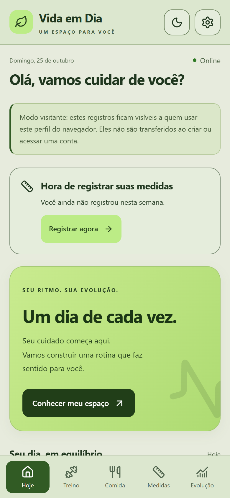
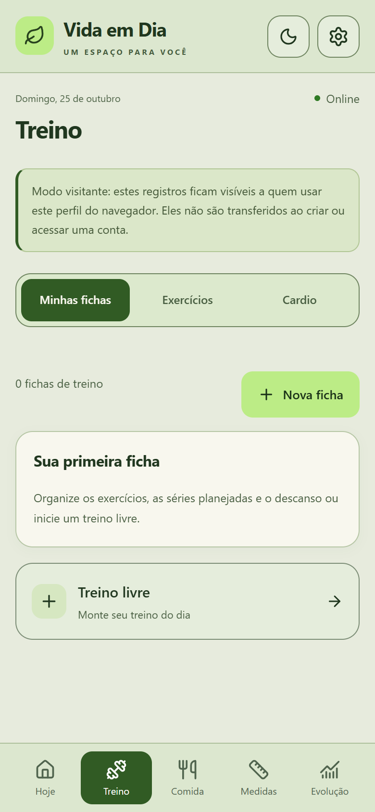
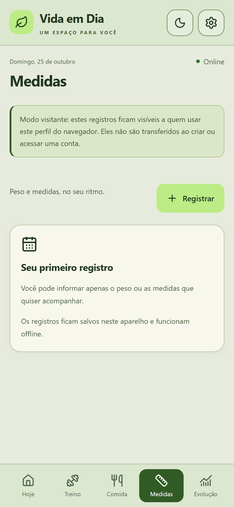
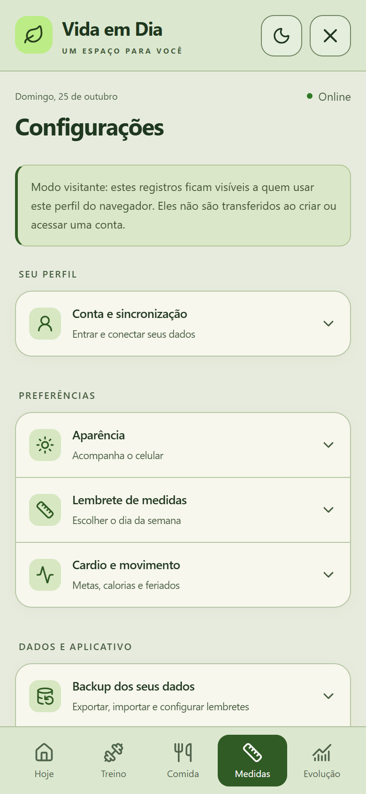

# Vida em Dia

**Treino, alimentação, água e evolução no seu ritmo.**

**[Abrir o aplicativo](https://vida-em-dia-breno-camargos-projects.vercel.app)**

## O que o app faz

Vida em Dia e uma PWA para acompanhar a rotina pelo celular ou computador, com temas claro, escuro e automático. Os registros ficam primeiro no aparelho; conta e sincronização permitem acessar os dados em outros dispositivos.

- **Treinos:** catálogo ampliavel, fichas personalizadas, treino livre, séries, cargas, repetições, descanso por exercicio e histórico.
- **Cardio e movimento:** duração, distância e detalhes por modalidade; calorias informadas ou estimadas, passos, metas e dias de descanso.
- **Alimentacao:** monte uma refeição com varios alimentos e calcule a porção consumida em gramas. Acompanhe calorias, proteínas, carboidratos, gorduras totais, fibras e sódio opcional.
- **Seus alimentos:** cadastre rótulos, edite seus produtos ou copie referencias do catálogo comum. Alterar o cadastro preserva os valores das refeições antigas.
- **Metabolismo e metas:** estimativa de gasto em repouso e com a rotina; metas alimentares definidas manualmente e comparadas com o total do dia. [Metodo e limites](docs/ENERGIA.md).
- **Agua:** capacidade da garrafa, meta diária, registro rápido e desfazer a última garrafa.
- **Medidas e evolução:** peso, medidas corporais, histórico, comparação entre datas e gráficos.
- **Compartilhamento:** cards do treino para salvar ou compartilhar pelos recursos disponiveis no navegador.
- **Conta e backup:** nome completo com saudação pelo primeiro nome, recuperação de senha, sincronização e backup JSON criptografado com fotos opcionais; exportacoes sem proteção identificadas.

## Interface

As imagens abaixo ilustram o visual; podem anteceder os refinamentos mais recentes. O app inclui tambem a aba Comida.

| Hoje | Treino | Medidas | Configurações |
| --- | --- | --- | --- |
|  |  |  |  |

## Armazenamento e limites

- Registros locais usam IndexedDB (Dexie). Depois do primeiro carregamento e cache, os recursos locais podem funcionar offline; login, sincronização e videos externos precisam de internet.
- Visitante e contas usam espaços locais separados. Dados do visitante não sao transferidos automaticamente ao criar uma conta.
- Fotos ficam no aparelho e podem ser incluidas no backup. Sincronizacao de fotos ainda não esta implementada.
- O descanso usa o horário de término para recompor o tempo ao voltar. O iPhone pode suspender áudio e execução em segundo plano; não ha garantia de bipes com a tela bloqueada.
- Estimativas energeticas não sao medições nem prescricoes. O catálogo alimentar comum e inicial e usa referencias; produtos de marca devem usar os valores do rótulo.
- Importacao de registros antigos e explicita. Mantenha uma copia de seguranca fora do app.
- Capacidade simultanea ainda não foi medida. Teste de carga sera feito com dados ficticios e banco separado de produção.

## Executar localmente

Use **Node.js 24**, a mesma versao principal da validação automatizada, e npm.

~~~bash
git clone https://github.com/breno-camargo/vida-em-dia.git
cd vida-em-dia
npm ci
npm run dev
~~~

Abra o endereço exibido pelo Vite (normalmente http://localhost:5173).
No Windows, use npm.cmd se o PowerShell bloquear npm.ps1.

A pasta principal se chama **vida-em-dia**; o nome anterior vida-em-dia-novo-visual foi aposentado. Copias antigas e evidencias locais ficam fora da raiz do app e não sao necessarias para executar o projeto.

### Conta e nuvem

Sem configuração de Supabase, o uso local permanece disponivel. Para habilitar conta e sincronização, copie .env.example para .env.local e preencha com os dados do seu projeto:

~~~env
VITE_SUPABASE_URL=https://seu-projeto.supabase.co
VITE_SUPABASE_PUBLISHABLE_KEY=sua_chave_publica
~~~

Variaveis VITE_ sao expostas ao navegador: nunca coloque service_role, senhas ou segredos nelas. Nao versione .env.local. A configuração do backend, migrações e funções esta em [supabase/](supabase/).

## Verificação

~~~bash
npm run typecheck
npm run lint
npm test
npm run build
~~~

Em **26/10/2026**, a entrega de alimentação passou em **322 testes, 56 arquivos**, tipagem, lint e build. O badge no topo mostra a situacao atual do CI; esta contagem e um registro datado, não uma garantia permanente. Conferencias de interface com Playwright foram feitas separadamente, com dados sinteticos.

A main e protegida: mudancas entram por pull request e check verificar aprovado. Prévia e produção sao publicacoes distintas.

## Instalar no celular

**iPhone:** abra o [app](https://vida-em-dia-breno-camargos-projects.vercel.app) no Safari, toque em Compartilhar e escolha Adicionar a Tela de Inicio.

**Android:** abra no Chrome e escolha Instalar aplicativo ou Adicionar a tela inicial no menu.

Instale preferencialmente antes de iniciar os registros. Safari e app instalado podem ter armazenamentos separados; cada endereço tambem possui seus proprios dados locais.

## Estrutura

~~~text
vida-em-dia/
  .github/workflows/   Validacao no GitHub Actions
  docs/               Plano, historico, metodos e imagens
  public/             Icones e arquivos estaticos
  src/componentes/    Paineis, seletores e componentes compartilhados
  src/dados/          Banco local, modelos, calculos e testes
  src/estilos/        Temas, superficies e controles
  src/hooks/          Comportamentos reutilizaveis
  src/sincronizacao/  Autenticacao, fila e conciliacao
  src/telas/          Hoje, Treino, Comida, Medidas e Evolucao
  src/utilitarios/    Funcoes de apoio
  supabase/           Migracoes, funcoes e configuracao do backend
~~~

Interface em React 19 e TypeScript, Vite, CSS com integracao Tailwind, IndexedDB/Dexie, Supabase, Recharts, Lucide e Vitest. As versoes efetivas estao no package.json e package-lock.json.

## Próximos passos

[Plano atual](docs/PLANO.md) | [Historico](docs/HISTORICO.md) | [Energia e metabolismo](docs/ENERGIA.md)

IA para registrar refeições por conversa, expansão do catálogo, sincronização de fotos e teste de carga seguem como evoluções; não fazem parte das funcionalidades concluídas.
